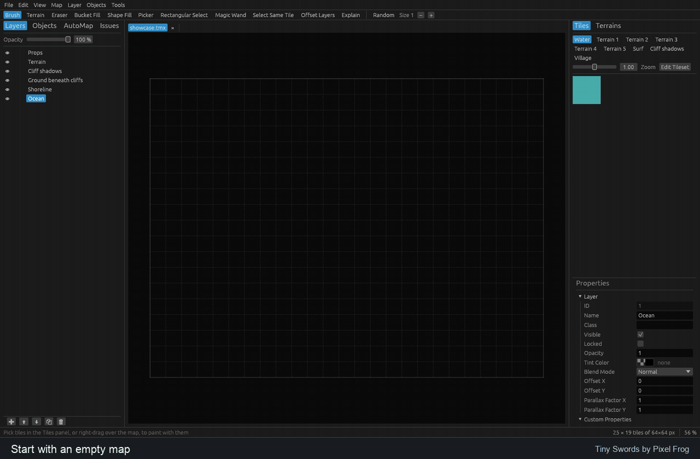

# better-tiled

A tilemap editor for [Tiled](https://www.mapeditor.org) maps, written in Rust, with a command
line for coding agents and an export to Godot 4.



Edit visually, work with agents through `bt`, and export to Godot.
[Showcase credits and recording instructions](docs/media/README.md).

- **Tiled's files stay Tiled's.** Maps, tilesets, templates, worlds and projects are read in
  every dialect Tiled has written since 1.0 and saved byte for byte as Tiled would save them.
- **Tiled's rules give Tiled's results.** Terrain sets and automapping rules behave as they do
  in Tiled, and every cell that could not be filled says what it needed.
- **Agents work with names.** `bt` edits maps by terrain, layer, sprite and shape names, with
  scripts that apply whole or not at all and reports that list problems first.
- **Godot work is never lost.** The Godot export regenerates scenes only where nothing changed
  since it wrote them, and a scene built on the export survives the map's renames.

## Status

Milestones M0–M5 are built ([design and build order](docs/design/00-high-level-design.md), §17):
file formats, rendering, tile and object editing, properties and custom types, terrain and
AutoMap tools, the agent CLI and live link, and safe Godot 4.3+ export.

The Godot exporter includes complete TileSets, stable identities, shared resources, animation,
collision, navigation and terrain data. Use File ▸ Godot Setup, then Export to Godot; or:

```bash
cargo run -p bt -- godot setup path/to/map.tmx --godot-project path/to/game
cargo run -p bt -- godot export path/to/map.tmx
cargo run -p bt -- godot verify path/to/game/levels/map.tscn
```

```bash
cargo run --release -p better-tiled -- path/to/map.tmx
```

## Documentation

| Where | What |
|---|---|
| [`docs/design/`](docs/design/) | one design doc per area: what it does, why, and how it is tested |
| [`docs/decisions.md`](docs/decisions.md) | every decision, dated, with the alternatives and why |

## Building and testing

```bash
cargo build
cargo test --workspace
```

The tests read Tiled's examples and test data, which are not part of this repository. Fetch them
once, at the commit the tests are pinned to:

```bash
scripts/fetch-reference.sh
```

Godot tests require Godot 4.3+; set `GODOT` to its executable when it is not on PATH. CI pins
Godot 4.7 on Linux. Rust 1.95.0 is pinned in `rust-toolchain.toml`.

A test whose data is missing fails and names it; `BT_SKIP_MISSING_TEST_DATA=1` turns that into
a skip that says what it skipped ([`docs/design/13-testing.md`](docs/design/13-testing.md)).

## License

The crates that port code from Tiled's editor (and the programs built on them) are licensed
under the GNU GPL, version 3 or later ([`LICENSE-GPL`](LICENSE-GPL)). The other crates are
licensed under either the MIT license ([`LICENSE-MIT`](LICENSE-MIT)) or the Apache License 2.0
([`LICENSE-APACHE`](LICENSE-APACHE)), at your option. Each crate's manifest names its license.
